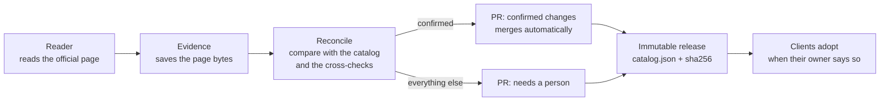

# AI Catalog

**Prices, models and effort levels for AI APIs, read from the providers' own pages every day, cross-checked, and published as versioned JSON with dated rates.**

[](https://github.com/openadviser/ai-catalog/actions/workflows/ci.yml)
[](LICENSE)


> **Status: foundation.** The repository structure, tooling and documentation are in place. The schema,
> the data, the readers and the clients arrive in later slices, and each directory says which.
> Nothing here is a price you can rely on yet.

## Why it exists

Anything that spends money on AI APIs needs the current price of a model, and needs to know when that
price changes. Prices live on pricing pages meant for people, and every consumer ends up keeping its own
copy, which goes stale. This catalog keeps one copy, with a paper trail.

- **Official pages are the only truth.** Every price is read from the provider's own page. Third-party
  datasets are read as a cross-check, never depended on.
- **Every price carries its source and date.** Each rate records the page it came from, when it was read
  and by which version of the reader.
- **Changes arrive as reviewed pull requests.** A change that two independent sources agree on, within a
  set factor, merges by itself. Anything else waits for a person.
- **Dated rates are first-class.** A rate that changes on a known date is stored as two validity windows,
  so a client prices a call at the rate that applied at that instant.
- **Every client prices the same way.** Exact decimal arithmetic, one rounding, and shared conformance
  vectors that every client release must pass.

## What a model looks like

An illustrative excerpt: the model, the numbers and the URL are made up, and the input rate steps up on
a known date. The exact field names are fixed by the schema in a later slice
([specification](docs/specification.md)).

```json
{
  "id": "example-model",
  "aliases": ["example-model-latest"],
  "status": "available",
  "capabilities": ["text"],
  "effort": { "levels": ["low", "medium", "high"], "default": "medium", "source": "..." },
  "offerings": [
    {
      "tier": "example:standard",
      "rates": [
        {
          "component": "input",
          "unit": "token",
          "per": 1000000,
          "amount": "1.00",
          "currency": "USD",
          "validUntil": "2027-01-01T00:00:00Z",
          "provenance": {
            "source": "example-pricing-page",
            "url": "https://example.com/pricing",
            "readAt": "2026-01-01T00:00:00Z",
            "readerVersion": "0.0.0"
          }
        },
        {
          "component": "input",
          "unit": "token",
          "per": 1000000,
          "amount": "2.00",
          "currency": "USD",
          "validFrom": "2027-01-01T00:00:00Z",
          "provenance": { "...": "as above" }
        }
      ]
    }
  ]
}
```

Amounts are decimal strings, never JSON numbers. A rate is valid in the half-open window
`[validFrom, validUntil)`. See [data format](docs/data-format.md).

## Quick start

Both clients behave the same way: load a catalog, check its hash and schema version, and price a call
for a model, a tier, a usage report and an instant.

**TypeScript** — coming in slice C5. A sketch of the planned shape:

```ts
// Planned API, not published yet.
const catalog = await load("<catalog.json URL or path>");
const price = catalog.price("example-model", "example:standard", usage, new Date());
```

**PHP 8.3+** — coming in slices P1 and P2, installed from the read-only mirror
`openadviser/ai-catalog-php`. A sketch of the planned shape:

```php
// Planned API, not published yet.
$catalog = $loader->load('<catalog.json URL or path>');
$price = $catalog->price('example-model', 'example:standard', $usage, $now);
```

Package names and install commands are published with the first release. See [clients](docs/clients.md).

## Coverage

Generated from [`data/catalog.json`](data/) by `npm run coverage:table`; CI fails if it is out of date.

<!-- coverage:start -->
_No catalog data yet. This table is generated from `data/catalog.json` and fills in with the first data release._
<!-- coverage:end -->

## How updates work



A scheduled workflow reads each source, and a reader that cannot read its page reports it as unreadable,
never as a zero. Every change is classed by how many independent sources agree. Releases are immutable
and addressed by version. Each client decides for itself when to adopt a new one. See the
[update policy](docs/update-policy.md) and [versioning](docs/versioning.md).

## Trust and limits

- **Not affiliated with any provider.** This is an independent project. Provider names are used only to
  say whose price is described.
- **The provider's invoice is authoritative.** The catalog is a best-effort reading of public pages. It
  can be wrong or late. Use it to estimate and to enforce budgets, and reconcile against the invoice.
- **Not modelled:** plan-based discounts, credits, free tiers and regional prices. Applications
  express those as their own overrides on top of the catalog.
- **A wrong price is a bug; a tampered price is a vulnerability.** See [SECURITY.md](SECURITY.md).

See [trust and provenance](docs/trust-and-provenance.md).

## Links

- Documentation: [data format](docs/data-format.md), [sources](docs/sources.md),
  [update policy](docs/update-policy.md), [versioning](docs/versioning.md),
  [adding a source](docs/adding-a-source.md), [clients](docs/clients.md),
  [trust and provenance](docs/trust-and-provenance.md), [specification](docs/specification.md)
- [Contributing](CONTRIBUTING.md) · [Code of conduct](CODE_OF_CONDUCT.md) · [Security](SECURITY.md) ·
  [Support](SUPPORT.md) · [Changelog](CHANGELOG.md)
- [MIT licence](LICENSE), for both the code and the data.
